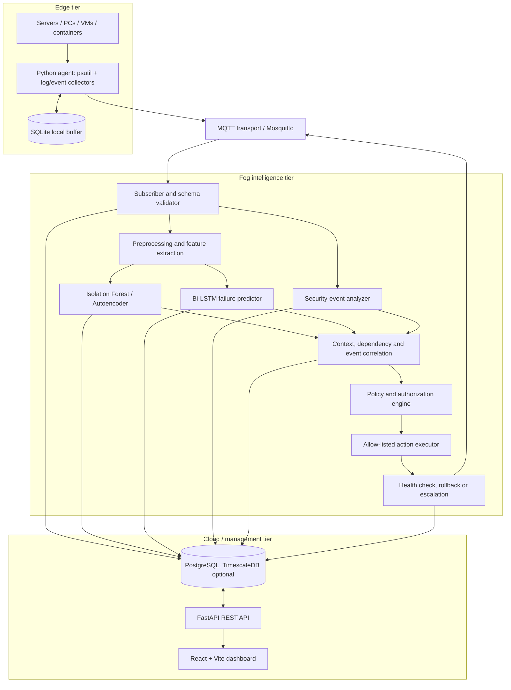
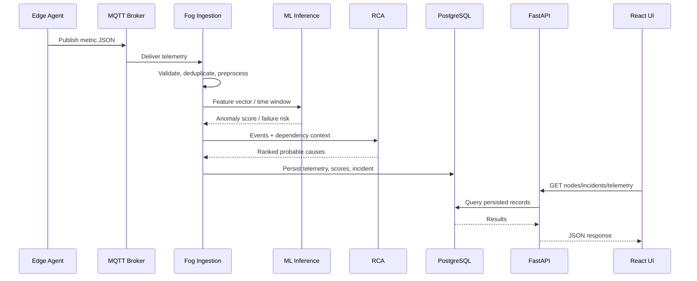
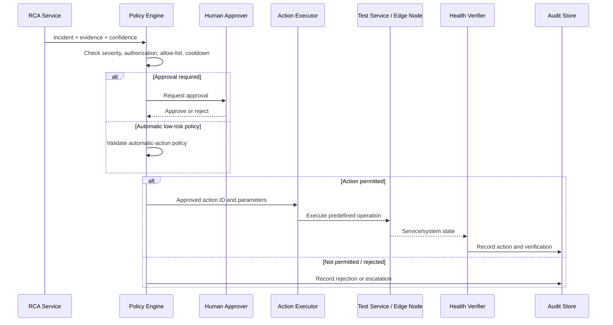
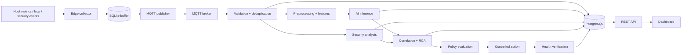
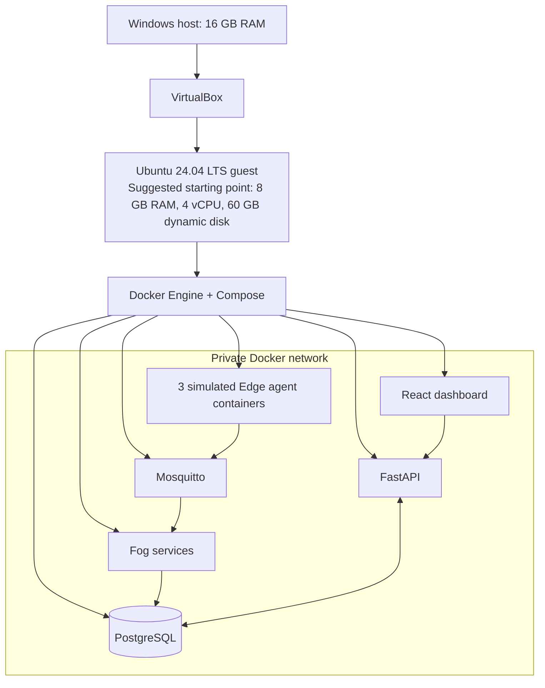

# PROJECT ARCHITECTURE

> Architecture record for **AI-Driven Autonomous Edge–Fog–Cloud Framework for Intelligent Infrastructure Management and Security**.
>
> **Status:** Proposed architecture consolidated from the uploaded project brief and accessible prior project discussions. It is not evidence that these components have been implemented. Verify against the source repository before coding.

## 1. Architectural principles

1. Place telemetry collection near the infrastructure source (Edge).
2. Place latency-sensitive preprocessing, inference, correlation and policy decisions at Fog.
3. Use Cloud for centralized persistence, management, reporting and visualization.
4. Separate model inference from action execution.
5. Never allow AI output to execute arbitrary shell commands.
6. Make events traceable through stable IDs, timestamps, node identity and audit records.
7. Design for temporary Edge–Fog disconnection using local buffering.
8. Treat RCA as evidence-based ranking of probable causes, not causal certainty.
9. Measure the benefit of Fog processing against a Cloud-only baseline.

## 2. High-Level Design

## 3. Component responsibilities (LLD)

### 3.1 Edge agent

**Proposed modules:** `collector.py`, `mqtt_client.py`, `buffer.py`, `config.py`, `main.py`.

- Collect CPU, RAM, disk, disk I/O and network counters using `psutil`.
- Collect service status and logs/security events only where the host exposes them and the project implements a collector.
- Add node ID, UTC timestamp, message ID, schema version and sequence number (the latter three are recommendations from prior design guidance).
- Serialize validated JSON and publish to MQTT.
- Persist unsent events to SQLite and replay after reconnection.
- Handle retries and duplicates idempotently.

No exact sampling period, retention policy or actual code is known.

### 3.2 MQTT transport

Mosquitto was selected as the proposed broker. The initial development proposal used Eclipse Mosquitto 2 and port 1883 on a private local network. Production-style deployment requires authentication, topic ACLs, TLS and restricted network exposure. QoS 1 was recommended for important telemetry; consumer-side deduplication is required because QoS 1 can deliver duplicates.

Proposed topics:

| Topic | Direction | Payload purpose |
|---|---|---|
| `infrastructure/edge/+/metrics` | Edge → Fog | Host metrics |
| `infrastructure/edge/+/logs` | Edge → Fog | Logs/events |
| `infrastructure/edge/+/security` | Edge → Fog | Security telemetry |
| `infrastructure/fog/anomaly` | Fog → Cloud/consumers | Anomaly result |
| `infrastructure/fog/predictions` | Fog → Cloud/consumers | Failure prediction |
| `infrastructure/fog/incidents` | Fog → Cloud/consumers | Correlated incident/RCA |
| `infrastructure/fog/actions` | Fog → Cloud/consumers | Remediation decision/result |
| `infrastructure/cloud/commands/+/+` | Cloud/control plane → Edge/Fog | Authorized command envelope; exact design TBD |

Exact ACLs, command acknowledgment, retained messages, QoS per topic and payload schemas are TBD.

### 3.3 Fog ingestion and processing

**Proposed modules:** `mqtt_subscriber.py`, `validator.py`, `preprocessing.py`, `feature_extraction.py`.

- Subscribe to telemetry topics.
- Validate schema, type, ranges, timestamp and node identity.
- Reject/quarantine invalid payloads; log validation failures.
- Deduplicate using message ID.
- Normalize units and handle missing values consistently with training.
- Build temporal windows for time-series models.
- Route processed features to anomaly, prediction and security services.

### 3.4 AI inference

- Isolation Forest: initial unsupervised baseline.
- Autoencoder: reconstruction-error anomaly detection.
- Bi-LSTM: temporal failure prediction where labeled sequence data supports it.
- PyTorch is the later recommended training framework; TensorFlow was also mentioned as an alternative in the source brief. Confirm framework before committing dependencies.
- ONNX Runtime is intended for Fog inference where export is compatible. It is not a model-training library.

Model registry, artifact format, versioning and hot-reload mechanism are not defined.

### 3.5 Security analysis

Analyze supplied security events and suspicious infrastructure behavior. The selected pAElla paper is a conceptual reference for edge AI malware detection; this does not mean the project already implements malware detection. Define supported event types and detection scope before making security claims.

### 3.6 Context and RCA

Inputs: anomaly results, predictions, logs, security events, temporal proximity and service dependency graph. NetworkX was proposed for an initial dependency graph. Dynamic knowledge graph implementation is not verified.

Conceptual ranking:

`Score(root_candidate) = w1*Correlation + w2*Temporal + w3*Dependency + w4*SeverityEvidence`

Weights, normalization, window sizes and confidence calibration are TBD. Output should include candidate cause, supporting evidence, affected components and confidence/score with explicit uncertainty.

### 3.7 Policy engine and remediation

Policy inputs:
- Incident severity.
- AI/model confidence.
- User/service authorization.
- Current system state.
- Cooldown/rate limits.
- Allow-listed action.
- Approval requirement.

Conceptual decision:

`Action = f(Severity, Confidence, Authorization, Cooldown, SystemState)`

The executor may perform only predefined operations such as restarting a disposable test service, reconnecting an agent or requesting diagnostics, after authorization. Exact action list is TBD. Verify health after each action; record actor, decision, timestamps, command identifier, result and verification. Failed actions should escalate. A rollback must not be claimed unless an operation has a safe compensating action and has been tested.

### 3.8 Cloud API and dashboard

Proposed backend: FastAPI. Proposed database: PostgreSQL. Proposed frontend: React + Vite and Recharts. Dashboard views should include node status, live/recent telemetry, anomalies, predictions, incidents/RCA evidence and remediation history. WebSocket/SSE live updates were not established; do not assume them.

## 4. Proposed sequence diagram: telemetry to alert

## 5. Proposed sequence diagram: controlled remediation

This diagram is conceptual. The approval interface, authorization model and executor protocol remain to be implemented/confirmed.

## 6. Proposed data-flow diagram

## 7. Database architecture (logical only)

Proposed entities:

- `edge_nodes` 1-to-many `telemetry`.
- `edge_nodes` 1-to-many `security_events` and other node-scoped events.
- `incidents` correlate multiple anomaly/prediction/security/event records.
- `incidents` 1-to-many `remediation_logs`.
- `users` may approve/reject remediation records.
- `policies` govern action eligibility.

Potential tables: `edge_nodes`, `telemetry`, `anomalies`, `predictions`, `security_events`, `incidents`, `remediation_logs`, `users`, `policies`.

No SQL schema, migrations, ERD or index definitions were available. Do not treat this logical list as an existing database.

## 8. Network and security architecture

Proposed local layout:
- Windows host runs VirtualBox.
- Ubuntu 24.04 guest runs Docker Engine/Compose.
- Containers communicate over a private Compose network.
- Only required development ports are published to the host.
- MQTT and PostgreSQL should not be publicly exposed.
- Secrets supplied through ignored environment files or a secret manager; `.env.example` contains placeholders only.

Exact VirtualBox adapter mode and subnet are UNKNOWN. Use least privilege, TLS/authentication for non-local use, MQTT topic ACLs, API JWT/RBAC, container non-root users where feasible, read-only filesystems where possible and constrained Linux capabilities.

## 9. Deployment architecture (proposed)

This is a proposed academic local deployment. Three Edge containers are preferred initially over three full VMs to conserve the 16 GB host memory. Actual deployment status is unknown.

## 10. Observability architecture

The available project materials require monitoring, logs, metrics, alerting and evaluation, but do not select Prometheus, Grafana, Loki, Alertmanager, OpenTelemetry or a tracing backend. Do not add these as current stack components without approval. Initially, provide structured application logs, health endpoints, timestamps, request/message IDs and recorded performance metrics. Evaluate whether a monitoring stack is necessary after the vertical slice works.

## 11. Architecture decisions and unresolved choices

| Decision | Current record | Status |
|---|---|---|
| Overall topology | Edge collects, Fog analyzes/acts, Cloud stores/manages/visualizes | Confirmed project concept |
| Host | Windows, 16 GB RAM | User constraint in prior context |
| Linux guest | Ubuntu 24.04 LTS on VirtualBox | Recommended setup |
| Containerization | Docker + Compose | Recommended setup |
| Edge telemetry | Python + psutil | Proposed |
| Offline buffer | SQLite | Proposed |
| Messaging | MQTT/Mosquitto | Proposed |
| Database | PostgreSQL; TimescaleDB optional | Proposed |
| Backend | FastAPI | Proposed |
| Frontend | React + Vite | Proposed |
| ML | Isolation Forest, Autoencoder, Bi-LSTM | Intended methods |
| Training framework | PyTorch preferred in later guidance; TensorFlow alternative in brief | Confirm |
| Fog inference | ONNX Runtime where compatible | Proposed |
| RCA graph | NetworkX initial graph; dynamic KG concept from base paper | Partially specified |
| Kubernetes/Terraform | Not established | Do not assume |
| Prometheus/Grafana/Loki | Not established | Do not assume |
| Cloud provider | Not established | UNKNOWN |

## 12. Architecture acceptance criteria

A first end-to-end milestone is accepted only when:
1. At least one agent publishes a documented telemetry payload.
2. Broker receives it on the expected topic.
3. Fog validates and rejects malformed messages safely.
4. Duplicate delivery does not create duplicate persisted telemetry.
5. PostgreSQL stores node-linked telemetry with UTC timestamps.
6. FastAPI returns the stored record through a tested endpoint.
7. Dashboard displays the node and telemetry.
8. Tests and startup instructions work from a clean checkout.

Subsequent milestones add local buffering/replay, AI, RCA, security and controlled remediation.
