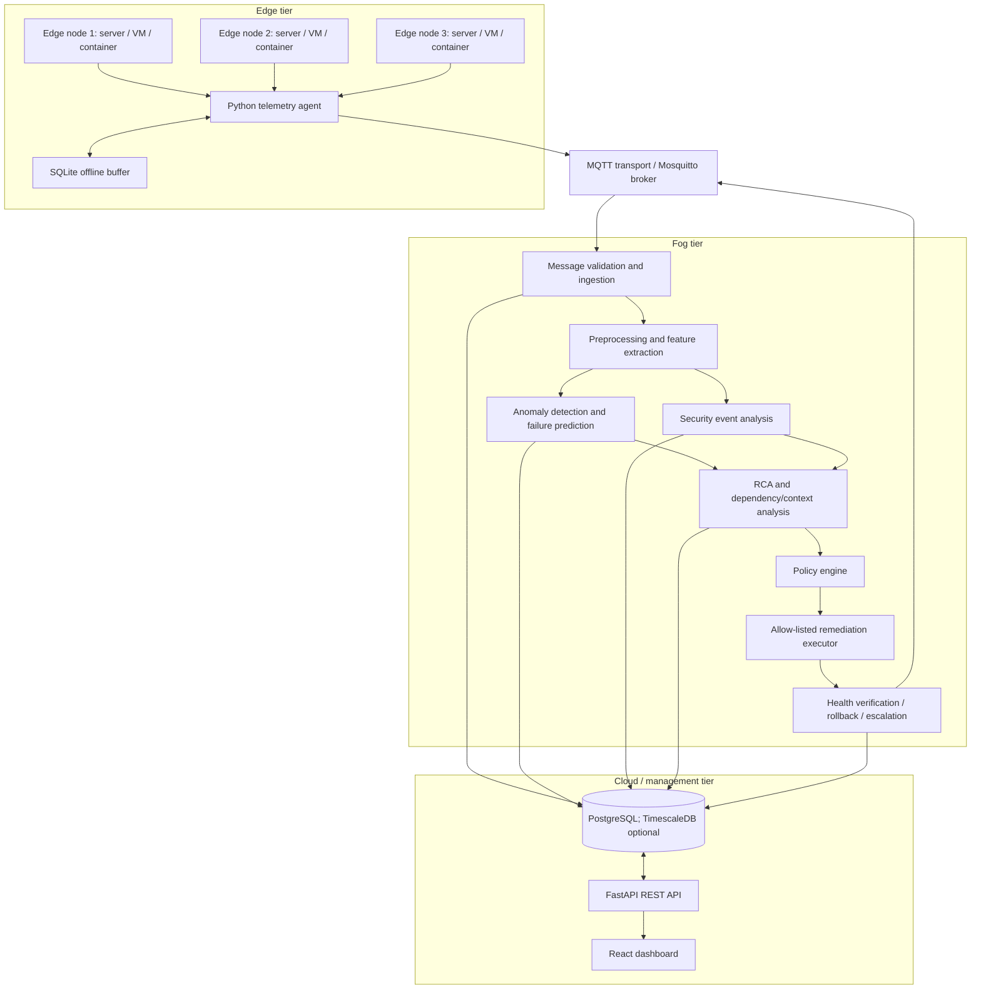

# PROJECT MASTER CONTEXT

> **Purpose:** Primary source of truth for Claude Code, Codex, and other AI coding agents continuing this B.E. CSE final-year project.
>
> **Evidence policy:** This document consolidates the uploaded `Project Breakdown Explanation.txt` and the accessible shared-project conversation summaries. It does not claim access to every conversation in the user's account or to an unprovided source repository. No working implementation has been verified from the available evidence.

## 1. Evidence, confidence, and status conventions

- **CONFIRMED REQUIREMENT / DECISION:** explicitly present in the project brief or accessible project history.
- **PROPOSED:** previously recommended or discussed; not proof of implementation or final approval.
- **UNKNOWN – Requires user confirmation:** the available sources do not establish the fact.
- **COMPLETED:** only use when working code, test evidence, or explicit user confirmation establishes completion.
- **NOT STARTED / UNKNOWN:** use when there is no implementation evidence. A design discussion is not implementation.

### Source coverage and limitations

Available material includes:
1. Uploaded `Project Breakdown Explanation.txt` (project title, scope, architecture, methodology, stack, team roles, selected literature, objectives and evaluation criteria).
2. Accessible shared-project conversation summaries covering project approval, project breakdown, Edge/Fog/Cloud explanation, Bi-LSTM, local setup recommendations, project timeline, team structure and next-step planning.

Not available for verification in this transfer:
- Full raw transcript of every historical conversation.
- Actual source-code repository and Git history.
- Actual Docker Compose, Dockerfiles, Kubernetes manifests, Terraform, database migrations or environment files.
- Terminal output, screenshots, test reports or deployment logs proving implementation.
- Exact complete uploaded research-paper corpus and bibliographic metadata for every paper.

Accordingly, implementation status is conservative. The receiving agent must inspect the real repository before changing code.

## 2. Project identity

- **Official project title:** AI-Driven Autonomous Edge–Fog–Cloud Framework for Intelligent Infrastructure Management and Security.
- **Project type:** B.E. Computer Science and Engineering final-year academic project.
- **Team size:** Three members.
- **Known teammates:** Ramesh and Yogesh are named in prior project context; the user's own name/role mapping is not established here.
- **Primary domain:** Distributed systems, Edge/Fog/Cloud computing, AIOps, AI/ML-based infrastructure monitoring, cybersecurity and controlled autonomous operations.
- **Project maturity evidenced by available sources:** requirements, architecture and planning discussions. Actual implementation state is UNKNOWN.

## 3. Executive summary

The proposed system is a distributed infrastructure intelligence and management framework. Edge agents collect infrastructure telemetry close to servers, PCs, VMs or containers. A Fog layer ingests and analyzes this information with preprocessing, context analysis, AI inference, security-event analysis and root-cause analysis. A policy engine determines whether a predefined remediation action is permitted. The Cloud layer stores historical information and exposes it to a management dashboard.

Central design principle:

> **Edge collects → Fog analyzes and acts → Cloud stores, manages and visualizes.**

The system is not intended to grant an AI model unrestricted control of infrastructure. Actions must be allow-listed, authorized and auditable, with confidence/severity checks, cooldowns, health verification, rollback or escalation where supported, and an emergency kill switch.

## 4. Problem statement and motivation

Distributed IT infrastructure generates system metrics, application/system logs, network events, security events and alerts. Centralized-only analysis can require large telemetry transfers and can delay response when remote connectivity or centralized processing is constrained. Monitoring, security analysis, failure prediction and remediation may also be fragmented across separate tools.

The project aims to demonstrate an integrated framework for:
- Infrastructure telemetry collection and monitoring.
- AI-assisted anomaly detection.
- Time-series failure prediction.
- Security-event and suspicious-behavior analysis.
- Evidence-based probable root-cause ranking.
- Controlled remediation and health verification.
- Centralized historical storage and visualization.
- Measurement of latency, traffic, resource overhead and recovery outcomes.

## 5. Objectives and scope

### 5.1 Objectives recorded in the project brief

1. Design an integrated Edge–Fog–Cloud framework for real-time infrastructure monitoring.
2. Develop AI-based anomaly detection and failure prediction; a performance target of at least 90% was stated, but it is a target and not a verified result.
3. Implement Fog-level processing, security analysis and RCA; sub-second detection latency was stated as a target, not a demonstrated result.
4. Develop policy-driven remediation with authorized actions and health verification.
5. Evaluate latency, network traffic, resource usage, detection performance and recovery time.

### 5.2 Intended telemetry

- CPU utilization.
- RAM utilization.
- Disk usage and disk I/O.
- Network traffic / sent and received bytes.
- Application and system logs.
- Service health and infrastructure events.
- Security telemetry available from the monitored environment.

### 5.3 Intended target environments

Potential real-world application domains discussed:
- Data centers and cloud/enterprise infrastructure.
- Distributed servers, virtual machines and containers.
- Smart manufacturing infrastructure.
- IoT and distributed environments.
- Networked infrastructure.

**Academic implementation boundary:** prior guidance recommends demonstrating the architecture locally using a Windows host, an Ubuntu VM and Docker containers, with simulated Edge nodes. No actual industrial deployment is evidenced. Do not describe a simulated setup as a production deployment.

### 5.4 Target users

- IT administrators.
- Data-center operators.
- Cloud infrastructure teams.
- Security/operations teams.

## 6. System architecture

### 6.1 High-level responsibilities

| Layer | Responsibility | Candidate components | Evidence status |
|---|---|---|---|
| Edge | Collect metrics/logs/events; locally buffer telemetry; publish messages | Python agent, psutil, SQLite, MQTT client | Proposed design |
| Transport | Carry telemetry and authorized commands | MQTT, Mosquitto, TLS | Proposed design |
| Fog | Ingest, validate, preprocess, extract features, infer, correlate, decide and execute controlled actions | Python services, FastAPI where needed, scikit-learn, PyTorch, ONNX Runtime, NetworkX | Proposed design |
| Cloud | Persist history, manage incidents/models, expose API and reporting | PostgreSQL; TimescaleDB optional; FastAPI | Proposed design |
| Presentation | Display nodes, telemetry, anomalies, predictions, incidents and remediation | React, Vite, Recharts | Proposed design |
| Operations | Package and run components | Ubuntu, Docker, Docker Compose, Git | Proposed local setup |

### 6.2 Mermaid HLD



The diagram is a proposed logical architecture, not a verified deployment diagram. Exact broker placement, database access path and command channel must be settled during implementation. Avoid exposing PostgreSQL or unauthenticated MQTT to untrusted networks.

### 6.3 End-to-end processing flow

1. Edge agent samples host metrics and available events.
2. Agent validates/serializes telemetry and assigns node identity and timestamp.
3. If Fog is unreachable, Edge stores data locally in SQLite and retries later.
4. Agent publishes telemetry through MQTT.
5. Fog validates schema, handles duplicate message IDs and orders/handles timestamps.
6. Fog preprocesses data and extracts features/windowed time-series.
7. AI services score anomalies and estimate failure risk.
8. Security analysis evaluates supplied security telemetry and controlled test events.
9. RCA correlates metrics, logs, alerts, time and dependency relationships; it ranks probable causes rather than proving causation.
10. Policy engine evaluates severity, model confidence, authorization, cooldown, system state and action allow-list.
11. If permitted, executor performs a predefined action; otherwise it recommends, requests approval or escalates.
12. Health verification checks whether service/system state recovered. Failed actions are logged and escalated; rollback is only claimed where implemented and tested.
13. Cloud stores telemetry, predictions, anomalies, incidents and action history; dashboard retrieves them through the API.

### 6.4 Context and RCA model

A conceptual RCA score recorded in the project brief is:

`Score(r) = w1*C + w2*T + w3*D + w4*S`

where `C` is correlation evidence, `T` temporal relationship, `D` dependency relationship and `S` severity/supporting evidence. Weights and normalization are **UNKNOWN – Requires user confirmation**. Treat the score as a heuristic ranking, not causal proof.

The base-paper concept uses dynamic knowledge graphs for context-aware anomaly detection. Prior guidance proposed NetworkX for an initial dependency graph; a full dynamic knowledge graph is not confirmed as implemented.

## 7. AI/ML design

| Method | Intended role | Important implementation note | Status |
|---|---|---|---|
| Isolation Forest | Lightweight baseline unsupervised anomaly detector | Fit/threshold using training/validation data; calibrate false positives | Proposed |
| Autoencoder | Reconstruction-error anomaly detector | Train on representative normal data; choose threshold on validation data | Proposed |
| Bi-LSTM | Time-series failure prediction | Define labels, lookback window and prediction horizon; avoid future-data leakage | Proposed |
| ONNX Runtime | Fog inference runtime for supported exported models | Runtime/deployment tool, not a training algorithm; test operator compatibility | Proposed |

Autoencoder reconstruction error concept:

`E(x) = (1/n) * sum((x_i - x_hat_i)^2)`

The Bi-LSTM literature cited in the brief concerns task/job failure prediction in cloud data centers. The project's infrastructure-failure task must define its own target labels and validate that the source paper's method transfers appropriately. For real-time inference, a bidirectional model can use both directions inside an already observed input window; it must not consume samples from beyond the prediction time.

### 7.1 Training and inference pipeline (proposed)

1. Collect or generate reproducible infrastructure telemetry and labeled fault scenarios.
2. Validate schema, handle missing values and outliers, and split data by time/node where appropriate.
3. Normalize/scale features using parameters fitted only on training data.
4. Engineer point-in-time metrics and sequence windows.
5. Train Isolation Forest and Autoencoder for anomaly detection; train Bi-LSTM only when suitable labeled sequential data exists.
6. Select thresholds on validation data; retain a held-out test set.
7. Evaluate precision, recall, F1, false-positive rate, inference latency and resource use.
8. Export supported models to ONNX if deployment benefits justify it.
9. Load models in Fog inference service; version model, preprocessing configuration and thresholds together.
10. Monitor drift and periodically reassess model performance.

Dataset names, sample counts, labeling strategy, model hyperparameters, model artifacts and measured metrics are **UNKNOWN – Requires user confirmation**.

## 8. Security and safe automation

Security is an explicit project component, but the exact detection implementation is not evidenced. The intended analysis includes suspicious infrastructure behavior, security alerts and malware-related indicators where suitable telemetry/datasets are available. Do not claim comprehensive malware detection from generic system metrics.

Required design safeguards:
- MQTT authentication and topic ACLs; TLS for non-local/untrusted networks.
- API authentication and RBAC for sensitive endpoints.
- Secrets in environment/secret stores; never commit credentials.
- Allow-listed remediation functions; no arbitrary model-generated shell commands.
- Explicit approval policy for high-impact operations.
- Confidence/severity thresholds and cooldowns.
- Audit records for proposed, approved, rejected and executed actions.
- Health checks, timeout handling, rollback only where safe and supported, escalation and kill switch.
- Least-privilege containers and restricted network exposure.

Current implementation of these controls is UNKNOWN.

## 9. Proposed technology inventory

Only technologies with a stated project role are listed. A technology being listed does not establish that it is installed or used in source code.

| Area | Technology | Intended purpose | Evidence |
|---|---|---|---|
| Host OS | Windows (existing host) | Host environment for local development | User constraint in prior project context |
| VM OS | Ubuntu 24.04 LTS | Linux development/deployment guest | Recommended setup |
| Virtualization | VirtualBox | Run Ubuntu VM on Windows | Recommended setup |
| Containers | Docker, Docker Compose | Package Edge/Fog/Cloud services and simulate nodes | Proposed/recommended |
| Edge language | Python 3.12 | Telemetry agent and processing | Recommended |
| Metrics | psutil | CPU, memory, disk, network and process metrics | Proposed |
| Edge buffer | SQLite | Local offline telemetry buffer | Proposed |
| Messaging | MQTT, Eclipse Mosquitto | Edge–Fog telemetry and controlled command transport | Proposed |
| Backend | Python, FastAPI | REST API and selected service endpoints | Proposed |
| ML | scikit-learn | Isolation Forest baseline | Proposed |
| Deep learning | PyTorch (TensorFlow was also mentioned as an alternative) | Autoencoder/Bi-LSTM training | Framework choice not fully locked; PyTorch preferred in later setup guidance |
| Inference | ONNX Runtime | Run exported model inference at Fog | Proposed |
| RCA graph | NetworkX | Initial service/dependency graph operations | Proposed |
| Cloud database | PostgreSQL | Persistent telemetry and incident records | Proposed |
| Time-series DB | TimescaleDB | Optional PostgreSQL extension if justified | Optional, not confirmed |
| Frontend | React + Vite | Web dashboard | Proposed |
| Charts | Recharts | Dashboard visualizations | Proposed |
| Security | JWT, RBAC, TLS | API authorization and transport protection | Proposed |
| Version control | Git/GitHub | Source control and collaboration | Recommended |

Not evidenced/approved as project stack: Kubernetes, Terraform, Prometheus, Grafana, Loki, Alertmanager, cloud provider, LLM integration, tracing stack. These must not be silently added as existing components. They may be future options after scope approval.

## 10. Proposed data contracts and messaging

A telemetry example previously proposed:

```json
{
  "node_id": "edge-01",
  "timestamp": "2026-11-10T12:00:00Z",
  "metrics": {
    "cpu_percent": 85.5,
    "memory_percent": 72.4,
    "disk_percent": 68.2,
    "network_sent_bytes": 102400,
    "network_received_bytes": 204800
  },
  "status": "active"
}
```

Recommended additions from prior architecture guidance: `schema_version`, `message_id`, and `sequence_number`. These additions are recommendations, not verified current schema. Use UTC timestamps and document units and sampling interval.

Proposed MQTT topics:

- `infrastructure/edge/+/metrics`
- `infrastructure/edge/+/logs`
- `infrastructure/edge/+/security`
- `infrastructure/fog/anomaly`
- `infrastructure/fog/predictions`
- `infrastructure/fog/incidents`
- `infrastructure/fog/actions`
- `infrastructure/cloud/commands/+/+`

QoS 1 was recommended for important telemetry, with idempotent duplicate handling by message ID. Exact topic ACLs, retained-message policy, payload size limits, retry strategy and command acknowledgment schema remain to be specified.

## 11. API inventory

These routes were proposed in prior project planning; they are **not verified as implemented**.

| Method | Path | Intended purpose | Request/response details | Auth/status |
|---|---|---|---|---|
| GET | `/api/v1/nodes` | List registered nodes | Schema UNKNOWN | Auth design proposed; implementation UNKNOWN |
| GET | `/api/v1/nodes/{id}` | Node detail | Schema UNKNOWN | UNKNOWN |
| GET | `/api/v1/telemetry/latest` | Latest telemetry | Schema UNKNOWN | UNKNOWN |
| GET | `/api/v1/telemetry/history` | Historical telemetry | Query parameters UNKNOWN | UNKNOWN |
| GET | `/api/v1/anomalies` | List anomaly events | Schema UNKNOWN | UNKNOWN |
| GET | `/api/v1/predictions` | List failure predictions | Schema UNKNOWN | UNKNOWN |
| GET | `/api/v1/incidents` | List incidents | Schema UNKNOWN | UNKNOWN |
| GET | `/api/v1/incidents/{id}` | Incident details | Schema UNKNOWN | UNKNOWN |
| GET | `/api/v1/remediation` | Remediation history | Schema UNKNOWN | UNKNOWN |
| POST | `/api/v1/remediation/{id}/approve` | Approve eligible action | Body/schema UNKNOWN | Must be authorized; implementation UNKNOWN |
| POST | `/api/v1/remediation/{id}/reject` | Reject proposed action | Body/schema UNKNOWN | Must be authorized; implementation UNKNOWN |
| GET | `/api/v1/system/health` | Service health | Response schema UNKNOWN | UNKNOWN |

Do not implement these routes blindly before inspecting the actual backend and confirming request/response contracts.

## 12. Proposed database model

Proposed logical tables (not verified SQL schema):

- `edge_nodes`: node identity, metadata, status and registration.
- `telemetry`: timestamped metrics keyed to node.
- `anomalies`: model scores, severity, feature/context evidence and timestamps.
- `predictions`: failure-risk output, horizon, confidence and model version.
- `security_events`: event source, category, severity and evidence.
- `incidents`: correlated events, RCA ranking and lifecycle state.
- `remediation_logs`: proposed/approved/executed action, actor, result and verification.
- `users`: dashboard identity and role.
- `policies`: allowed action, conditions, approval and cooldown configuration.

Likely relationships: one node has many telemetry records and events; incidents correlate multiple events; incidents may have zero or more remediation attempts; users may approve/reject actions; policies govern action eligibility. Exact PK/FK design, indexes, retention, partitioning, migrations and SQL types are UNKNOWN. PostgreSQL is the baseline; TimescaleDB is optional and should only be added if justified by measured time-series workload.

## 13. Proposed repository structure

The following structure was recommended in prior discussions. It is **proposed, not verified against an actual repository**:

```text
ai-edge-fog-cloud/
├── edge/
│   └── agent/
│       ├── main.py
│       ├── collector.py
│       ├── mqtt_client.py
│       ├── buffer.py
│       └── config.py
├── fog/
│   ├── ingestion/
│   │   ├── mqtt_subscriber.py
│   │   └── validator.py
│   ├── processing/
│   │   ├── preprocessing.py
│   │   └── feature_extraction.py
│   ├── ai/
│   │   ├── anomaly_detector.py
│   │   ├── failure_predictor.py
│   │   └── inference.py
│   ├── security/security_analyzer.py
│   ├── rca/
│   │   ├── dependency_graph.py
│   │   └── root_cause.py
│   └── remediation/
│       ├── policy_engine.py
│       ├── executor.py
│       └── health_check.py
├── cloud/
│   ├── api/
│   │   ├── main.py
│   │   ├── routes/
│   │   ├── schemas/
│   │   └── services/
│   └── database/
│       ├── models.py
│       └── connection.py
├── dashboard/
│   └── src/
│       ├── components/
│       ├── pages/
│       ├── services/
│       └── App.jsx
├── ml-training/
│   ├── datasets/
│   ├── notebooks/
│   ├── train_isolation_forest.py
│   ├── train_autoencoder.py
│   ├── train_bilstm.py
│   └── models/
├── mosquitto/config/
├── database/init.sql
├── docker-compose.yml
├── .env.example
├── .gitignore
└── README.md
```

## 14. Local development environment and deployment decisions

Known constraint: Windows host with 16 GB RAM. Prior recommendation:
- Windows host.
- VirtualBox guest running Ubuntu 24.04 LTS.
- Initial VM allocation around 8 GB RAM, 4 vCPUs and 60 GB dynamically allocated disk.
- Docker Engine and Docker Compose plugin inside Ubuntu.
- Run several simulated Edge agents and Fog/Cloud components as containers before considering multiple full VMs.

These are recommended starting values, not verified current configuration. Adjust for host CPU, available disk and actual workload. Avoid allocating all host RAM to the VM.

### Network approach

A bridged or host-only/NAT arrangement was discussed as a configuration choice, but the exact final network mode is UNKNOWN. For initial local development, keep services on a private Docker network; expose only required development ports to the host. Do not publish MQTT, PostgreSQL or administrative interfaces to public networks.

### Previously suggested Compose services

A starter Compose design included:
- `mqtt`: `eclipse-mosquitto:2`, initially port 1883 for local development.
- `database`: `postgres:16`, persistent volume and health check.
- `fog`: built from `./fog`, configured with MQTT host/port and database URL.
- `cloud-api`: built from `./cloud`, port 8000, depends on database health.
- `dashboard`: built from `./dashboard`, container port 80 mapped to host port 3000.
- Volumes for MQTT and PostgreSQL data.

No exact Compose file is available in the evidence. This is a design outline, not a reproducible configuration. It requires Dockerfiles, Mosquitto config, health checks, `.env`, database initialization and secure settings.

### Environment variable names previously mentioned

- `DB_PASSWORD`
- `DATABASE_URL`
- `MQTT_HOST`
- `MQTT_PORT`

Additional variables must be discovered from source code. Never store actual values in this document or Git.

### Commands

No exact verified installation transcript or successful command log was recovered. Use official Ubuntu/Docker documentation when installing and verify the host before running commands. Expected verification commands (proposed, not historical evidence):

```bash
lsb_release -a
docker --version
docker compose version
docker run --rm hello-world
git --version
python3 --version
```

Expected project startup command if a Compose file exists and is valid:

```bash
docker compose up -d --build
docker compose ps
docker compose logs -f
```

Do not run until inspecting the actual `docker-compose.yml` and `.env.example`.

## 15. Testing and evaluation

### 15.1 Proposed reproducible scenarios

| Scenario | Controlled stimulus | Expected observation |
|---|---|---|
| CPU overload | Generate controlled CPU load on a test node | Telemetry rises; anomaly detector may flag it |
| Memory pressure | Allocate bounded memory in test process | Memory trend/threshold anomaly is detected |
| Disk pressure | Increase test filesystem usage safely | Disk alert is generated |
| Service failure | Stop a disposable test service | Failure is detected and recovery policy evaluated |
| Edge–Fog disconnect | Block/disconnect test connection | Local buffer retains telemetry |
| Reconnection | Restore connectivity | Buffered data is replayed without duplicate persistence |
| Synthetic security event | Publish controlled test event | Security analyzer records an alert |
| Dependency failure | Stop a dependency in test service graph | RCA ranks impacted component as probable cause |
| Remediation failure | Configure test action to fail | Failure is audited and escalated |
| Normal baseline | Run stable workload | False positives are measured |

### 15.2 Metrics

AI: accuracy (only when labels and class balance make it meaningful), precision, recall, F1, false-positive rate, confusion matrix and inference time.

System: end-to-end detection latency, ingestion/processing latency, CPU/RAM overhead, network bytes and message loss/duplication.

Remediation: time to recovery, action success rate, health-verification success, rollback/escalation behavior and false remediation rate.

Architecture comparison: Fog-based versus Cloud-only processing using identical workloads and datasets. Define measurement boundaries and repeat trials.

Targets of >=90% and sub-second detection are aspirations only. No actual results were available in source material.

## 16. Team responsibilities

Three-member responsibility split previously proposed (not confirmed assignment to individual names):

1. **Edge and Fog infrastructure:** Python agents, psutil, SQLite buffer, MQTT/Mosquitto, ingestion, Docker and infrastructure remediation integration.
2. **AI/ML:** dataset generation/preparation, features, Isolation Forest, Autoencoder, Bi-LSTM, evaluation, ONNX export and Fog inference.
3. **Security, Cloud and Frontend:** security events, RCA, NetworkX dependency graph, policy engine, audit/remediation workflow, PostgreSQL, FastAPI and React dashboard.

Ramesh and Yogesh are named as teammates in prior context. Exact student-to-role mapping is UNKNOWN – Requires user confirmation. All team members should share integration, testing, documentation and presentation responsibilities.

## 17. Literature and research context

The uploaded brief identifies the following papers. Bibliographic metadata should be checked against the original PDFs/IEEE records before submission; no DOI/page details are asserted here.

| Paper label in brief | Title | Project relevance |
|---|---|---|
| Base paper / Paper 14 | “Toward Context-Aware Anomaly Detection for AIOps in Microservices Using Dynamic Knowledge Graphs” (2026; authors listed in source brief: Pieter Moens, Bram Steenwinckel, Femke Ongenae, Bruno Volckaert, Sofie Van Hoecke) | Context-aware anomaly detection and dynamic dependency/knowledge graph concepts |
| Paper 1 | “Task Failure Prediction in Cloud Data Centers Using Deep Learning” (2022; author details in prior summary: Jiechao Gao, Haoyu Wang, Haiying Shen) | Deep learning and Bi-LSTM failure prediction |
| Paper 4 | “Anomaly Detection Algorithms for Real-Time Log Data Analysis at Scale” | Log anomaly detection and scalable processing; complete metadata UNKNOWN |
| Paper 17 | “pAElla: Edge AI-Based Real-Time Malware Detection in Data Centers” (2020; prior summary: Antonio Libri, Andrea Bartolini, Luca Benini) | Edge AI security analysis |
| Paper 13 | “NetEventCause: Event-Driven Root Cause Analysis for Large Network System Without Topology” (2025; authors listed in source brief) | Event-driven RCA and temporal relationships |
| Paper 2 | “A Comprehensive Monitoring, Visualization, and Management System for Green Data Centers” | Monitoring, visualization and management; complete metadata UNKNOWN |

The project brief states that Paper 14 is the selected base paper. Earlier project context also mentions a Cloud Forensics PDF, but its detailed contents are not available in this transfer source. Re-open and review the original PDF before deciding its exact role.

### Research-gap wording to validate

The proposed research gap is that the selected studies address individual aspects—context-aware anomaly detection, failure prediction, log analysis, security, RCA and infrastructure management—while this project aims to integrate them into a single Edge–Fog–Cloud framework with controlled remediation. This is a proposed synthesis, not a proven exhaustive literature claim. Validate it through a structured comparison of papers and avoid saying that no prior system exists unless the survey supports that statement.

## 18. Known limitations and unresolved decisions

- Actual repository location and current branch: UNKNOWN – Requires user confirmation.
- Implemented modules and working status: UNKNOWN – Requires repository inspection.
- Final VM network mode: UNKNOWN.
- Exact Docker Compose/Dockerfiles: UNKNOWN.
- Final training framework: PyTorch was recommended later; source brief also permits TensorFlow. Confirm before dependency lock-in.
- Dataset source, license, labels, size and prediction target: UNKNOWN.
- Exact sampling interval, feature schema version and message retention: UNKNOWN.
- Final API request/response contracts: UNKNOWN.
- Exact database schema and migrations: UNKNOWN.
- Exact knowledge graph implementation: UNKNOWN; NetworkX was proposed for an initial graph.
- Security telemetry source and malware-detection scope: UNKNOWN.
- Remediation action list and approval matrix: UNKNOWN.
- Kubernetes, Terraform, Prometheus, Grafana, Loki, Alertmanager, cloud provider and LLM integration: not established as selected or implemented.
- Paper DOI, volume, issue and page metadata: verify original sources.

## 19. Immediate next actions for the receiving coding agent

1. Inventory the actual repository: `pwd`, `find . -maxdepth 3 -type f`, Git status/log, package manifests, Docker files and tests.
2. Produce an evidence-based implementation inventory; map actual files to features and run existing tests before editing.
3. Confirm the VM/Ubuntu/Docker environment and record versions.
4. Establish the smallest vertical slice: one Edge agent publishes a versioned metric message → MQTT broker → Fog validator → PostgreSQL persistence → API endpoint → dashboard display.
5. Add automated tests for message schema, duplicate handling and database persistence.
6. Add local SQLite buffering/replay and test disconnect/reconnect.
7. Implement baseline anomaly detection with reproducible synthetic scenarios before deep-learning models.
8. Define failure-prediction labels and prediction horizon before training Bi-LSTM.
9. Add event correlation/RCA, then security analysis, then controlled remediation with a disposable test service.
10. Add performance comparison, documentation and demo scripts.

Do not begin with Kubernetes, Terraform, complex dynamic knowledge graphs or LLM agents. First establish a reliable, observable, testable end-to-end local system.

## 20. Related documents

- [PROJECT_ARCHITECTURE.md](PROJECT_ARCHITECTURE.md) — architecture and data flows.
- [IMPLEMENTATION_STATUS.md](IMPLEMENTATION_STATUS.md) — evidence-based feature status.
- [DEVELOPMENT_ROADMAP.md](DEVELOPMENT_ROADMAP.md) — phased implementation plan.
- [KNOWN_ISSUES.md](KNOWN_ISSUES.md) — known unknowns and debugging history.
- [TECH_STACK_AND_SETUP.md](TECH_STACK_AND_SETUP.md) — stack and local setup.
- [CLAUDE_AGENT_INSTRUCTIONS.md](CLAUDE_AGENT_INSTRUCTIONS.md) — coding-agent operating rules.
